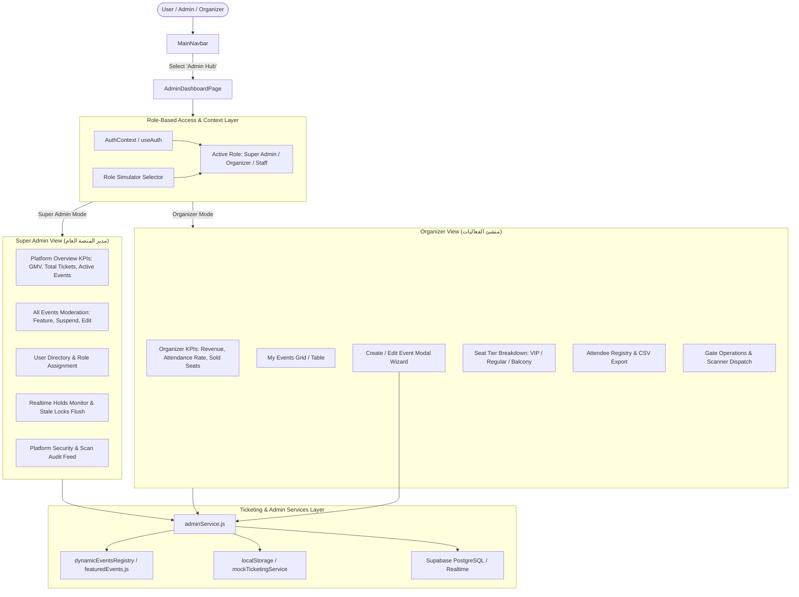

# Implementation Plan: Centralized Super Admin & Event Organizer Control Panel

**Feature Code:** `FEAT-ADMIN-05`  
**Specification Code:** `SPEC-05-centralized-control-panel`  
**Parent Intent:** [`intent/interactive-event-ticketing.md`](file:///f:/SHADI/2-Programming/Interactive%20Event%20Ticketing%20Platform/interactive-event-ticketing-platform/intent/interactive-event-ticketing.md)  
**Parent Guidelines:** [`AGENTS.md`](file:///f:/SHADI/2-Programming/Interactive%20Event%20Ticketing%20Platform/interactive-event-ticketing-platform/AGENTS.md), [`.agents/rules/guidelines.md`](file:///f:/SHADI/2-Programming/Interactive%20Event%20Ticketing%20Platform/interactive-event-ticketing-platform/.agents/rules/guidelines.md), [`.agents/rules/ticketing-domain.md`](file:///f:/SHADI/2-Programming/Interactive%20Event%20Ticketing%20Platform/interactive-event-ticketing-platform/.agents/rules/ticketing-domain.md)  
**Status:** In Review (Pending User Approval)  

---

## 1. Goal Description (وصف الهدف والغاية)

بناء لوحة تحكم مركزية متكاملة (**Centralized Control Panel**) بنظام الأدوار المزدوج (**Dual-Role Management**) تخدم كلاً من:
1. **الأدمن الأعلى للمنصة (Super Admin):**
   - مراقبة مؤشرات الأداء الحيوية لكامل المنصة (Platform KPIs): إجمالي حجم المبيعات (GMV)، عدد الحجوزات والتذاكر الصادرة، نسبة الإشغال العامة، وعمولات المنصة.
   - حوكمة وإدارة الفعاليات عبر جميع المنظمين (موافقة، تعليق، تمييز الفعالية بالصفحة الرئيسية `Featured`).
   - إدارة المستخدمين وصلاحياتهم (RBAC: Super Admin, Organizer, Gate Staff, Attendee).
   - لوحة مراقبة الأقفال والتزامن اللحظي (Active Holds Monitor)، وأداة تحرير المقاعد المعلقة يدوياً أو آلياً عند انتهاء الـ 300 ثانية.
   - سجل رقابي وأمني مباشر للعمليات (Audit Log: عمليات الشراء الكبرى ومسح البوابات).

2. **منشئو الحفلات والفعاليات (Event Organizers / Creators):**
   - لوحة عمل المنظم (Organizer Workspace): إحصائيات فعالياته الخاصة، الإيرادات المباشرة، ونسبة الحضور الفعلي عند البوابات.
   - معالج إنشاء وتعديل الفعاليات (**Event Creation & Editing Wizard**): إضافة فعالية جديدة بكامل بياناتها (عربي وإنجليزي)، تحديد القاعة، فئات التذاكر، الأسعار، والسعة الاستيعابية.
   - تحليل مبيعات الفعالية وتوزيع المقاعد (Tier Breakdown: VIP, Regular, Balcony).
   - كشف الحضور والتذاكر المباعة (**Attendee & Ticket Registry**): جدول تفاعلي بالبحث والتصفية مع زر تصدير كشف الحضور بصيغة **CSV**.
   - تشغيل البوابات وتفويض طاقم التفتيش (**Gate Staff Delegation**): إحصائيات بوابات الدخول ورابط مباشر لماسح البوابات للفعالية المحددة.

3. **التجربة وثنائية اللغة والتبديل المرن (UX & RBAC):**
   - محوّل أدوار سريع (**Role Simulator Pill**) لتمكين التبديل الفوري بين وضع الأدمن الأعلى ووضع المنظم للتجربة والاختبار دون تعقيد.
   - دعم كامل للغتين العربية (افتراضياً RTL) والإنجليزية (LTR) متوافق مع نظام `useLanguage`.
   - دمج كامل في شريط التنقل `MainNavbar` مع الحفاظ على التوافق التام مع الجوال والشاشات المختلفة.

---

## 2. Architecture & Data Flow Diagram

---

## 3. User Review Required (نقاط تتطلب مراجعة المستخدم)

> [!IMPORTANT]
> **التخزين وتزامن الفعاليات (Dynamic Events Persistence):**
> حالياً يتم قراءة الفعاليات من `featuredEvents.js`. سنقوم بإنشاء خدمة متقدمة `adminService` تدمج الفعاليات الافتراضية مع الفعاليات المنشأة أو المعدلة حديثاً في `localStorage` (للتشغيل الفوري والمحاكاة) مع تجهيزها للربط المباشر مع جدول `events` في Supabase عند توفر الاتصال. هذا يضمن أن أي فعالية يضيفها المنظم تظهر فوراً في الصفحة الرئيسية وفي صفحة حجز المقاعد.

> [!TIP]
> **مبدل الأدوار السريع (Role Simulation Switcher):**
> لتسهيل مراجعة واختبار كلا الوضعين (الأدمن الأعلى ومنشئ الفعاليات) دون الحاجة لتسجيل الخروج والدخول بحسابات مختلفة، سنوفر خياراً أنيقاً في أعلى لوحة التحكم يتيح التنقل بنقرة زر واحدة بين:
> - **Super Admin (الأدمن الأعلى)**
> - **Event Organizer (منشئ الحدث)**
> - **Gate Staff (طاقم البوابة)**
> - **Standard Attendee (الزائر العادي)**

---

## 4. Open Questions (أسئلة مفتوحة)

1. **تصدير كشف الحضور (Attendee Roster Export):** سنعتمد تصدير ملفات CSV مشفرة بـ UTF-8 مع تضمين الـ BOM لضمان فتح الأسماء العربية بشكل سليم ومثالي في برامج Excel و Google Sheets.
2. **سعة القاعات للفعاليات الجديدة:** عند إنشاء فعالية جديدة، نوفر خيار ربطها بالقاعة التفاعلية القياسية (520 مقعداً) مع إمكانية تحديد الأسعار لكل فئة (VIP, Regular, Balcony).

---

## 5. Proposed Changes & Touchpoints (التغييرات المقترحة)

### Component Area 1: Admin Feature Module (`src/features/admin/`) [NEW]
- `src/features/admin/services/adminService.js`
- `src/features/admin/hooks/useAdminData.js`
- `src/features/admin/components/AdminHeader.jsx`
- `src/features/admin/components/SuperAdminOverview.jsx`
- `src/features/admin/components/OrganizerOverview.jsx`
- `src/features/admin/components/EventsManagementTab.jsx`
- `src/features/admin/components/CreateEditEventModal.jsx`
- `src/features/admin/components/AttendeeRosterTab.jsx`
- `src/features/admin/components/UsersManagementTab.jsx`
- `src/features/admin/components/SystemHealthTab.jsx`
- `src/features/admin/AdminDashboardPage.jsx`
- `src/features/admin/AdminDashboard.css`
- `src/features/admin/index.js`

### Component Area 2: Application Navigation & Context Integration
- [MODIFY] `src/App.jsx`
- [MODIFY] `src/features/landing/LandingPage.jsx` & `src/features/landing/featuredEvents.js`
- [MODIFY] `src/i18n/translations.js`

---

## 6. Verification & Testing Plan (خطة التحقق والاختبارات)
- **Automated Vitest Tests (`tests/features/admin-dashboard.test.jsx`)**
- **Manual Verification Guide**
